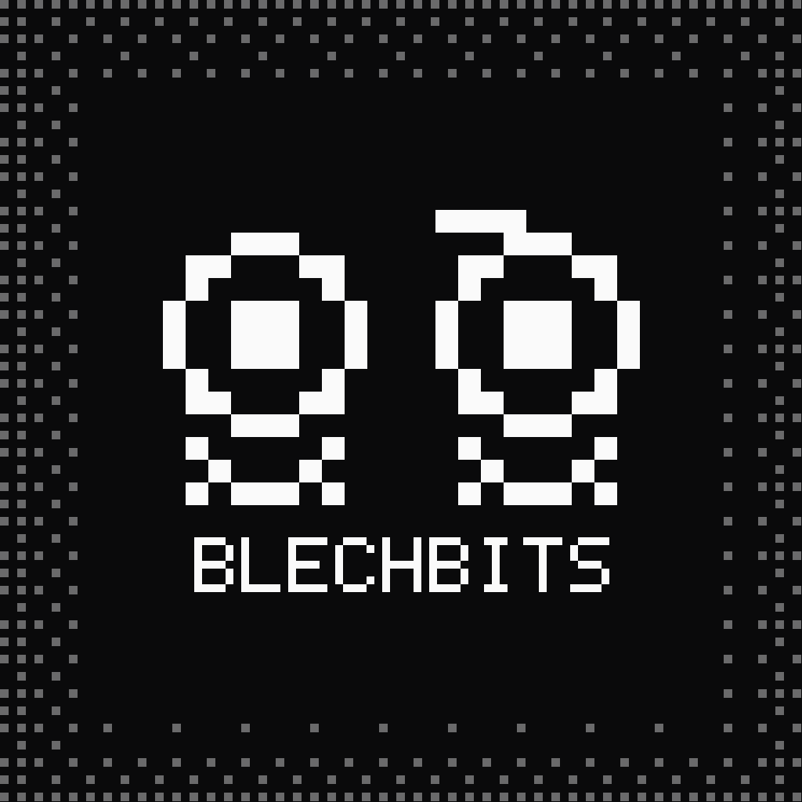

<p align="center">
  
</p>
<h1 align="center" >
  <strong>BlechBits</strong>
</h1>
Ein Tool zur Konvertierung von Bitmap dateien in Arrays und Erstellung von BLECHTRIBE-Plugins. BlechBits erweitert den bestehenden Workflow um die Möglichkeit, Plugin-Namen anzupassen und fertige `.blech`-Dateien zu erstellen.

<br><br>
<h2 align="center" >
  <strong>Features</strong>
</h2>

- **BMP-Konvertierung** – Bitmap-Dateien für die Verwendung in BLECHTRIBE-Plugins konvertieren.
- **Eigener Plugin-Name** – Den Namen des Plugins individuell festlegen.
- **Plugin-Kompilierung** – Plugin-Code mit dem BLECHTRIBE-Compiler kompilieren.
- **`.blech`-Export** – Kompilierte Plugins als fertige `.blech`-Datei exportieren.
- **Compiler-Fehler** – Fehlermeldungen mit Zeilen- und Spaltenangaben anzeigen.
  
<br><br>
<h2 align="center" >
  <strong>Installation</strong>
</h2>

Ab v.1.0.1 gibt es eine Portable sowie eine Installierbare Version.
Das ganze ist durch den Suffix "-Portable" und "-Setup" erkennbar.

Die Portable Version ladet ihr runter, öffnet sie und fertig. Bei jeder Nutzung müsst ihr dann diese .exe Datei öffnen.
Die Installer Version ist für die Jenigen gut, die öfters Bitmaps zu Blechtribe Plugins umwandeln wollen. Dann ist BlechBits auf eurem PC installiert, bis ihr es Deinstalliert.


Viel Spaß beim Ab-Blechen

<br><br>
<h2 align="center" >
  <strong>Von Source-Compilen</strong>
</h2>

<h3 align="center" >
  <strong>Vorraussetzungen</strong>
</h3>

- [Node.js](https://nodejs.org/) und npm
- Das heruntergeladene oder geklonte BlechBits-Projekt

<h3 align="center" >
  <strong>Schritte</strong>
</h3>

1. Repository herunterladen oder klonen.
2. Im Projektverzeichnis ein Terminal öffnen.
3. Abhängigkeiten installieren:

   ```bash
   npm install
   ```

4. BlechBits starten:

   ```bash
   npm run start
   ```

<h3 align="center" >
  <strong>Windows-Build</strong>
</h3>

Falls das Projekt das entsprechende Build-Skript enthält, kann eine Windows-Version erstellt werden:

```bash
npm run build:win
```

<br><br>
<h2 align="center" >
  <strong>Verwendung</strong>
</h2>

1. BlechBits starten.
2. Die gewünschte Bitmap-Datei importieren und konvertieren.
3. Einen Namen für das Plugin festlegen.
4. Den Plugin-Code kompilieren.
5. Die erzeugte `.blech`-Datei speichern.

Der festgelegte Plugin-Name wird als erstes Argument in `korg.app()` verwendet. Beispiel:

```javascript
korg.app("MeinPlugin", "TOOLS");
```

Der Name muss den Vorgaben des BLECHTRIBE-Compilers entsprechen.

<br><br>
<h2 align="center" >
  <strong>Hinweise</strong>
</h2>

- Nicht beliebiger JavaScript-Code ist mit der BLECHTRIBE-Skriptsprache kompatibel.
- Ob ein Plugin auf dem Zielgerät funktioniert, hängt unter anderem von der verwendeten API und dem Plugin-Code ab.
- Prüfe vor einer Veröffentlichung die Lizenzbedingungen des Originalprojekts sowie aller eingebundenen Komponenten.
- Ich übernehme keinerlei haftung falls ihr eure Electribe wieso auch immer brickt

<br><br>
<h2 align="center" >
  <strong>Disclaimer</strong>
</h2>

- Beim erstellen von Blechbits wurde Original Code Teile verwendet.
  Die Dateien in `./src ` gehören zu [Kuhler's Gelumpe](https://github.com/KuhlerBuhler/kuhlers-gelumpe)
- Beim erstellen von Blechbits wurde KI genutzt. (Zum Compilen zu .blech dateien und für's Design, ich bin echt kein guter Web Dsigner :D)


<br><br>
<h2 align="center" >
  <strong>Lizenz</strong>
</h2>


AGPL-3.0, [`LICENSE`](LICENSE). Sonstige hinweise stehen in [`NOTICE`](NOTICE)


---
<p align="center">
<strong>BlechBits</strong> – BMP zu .BLECH
</p>
